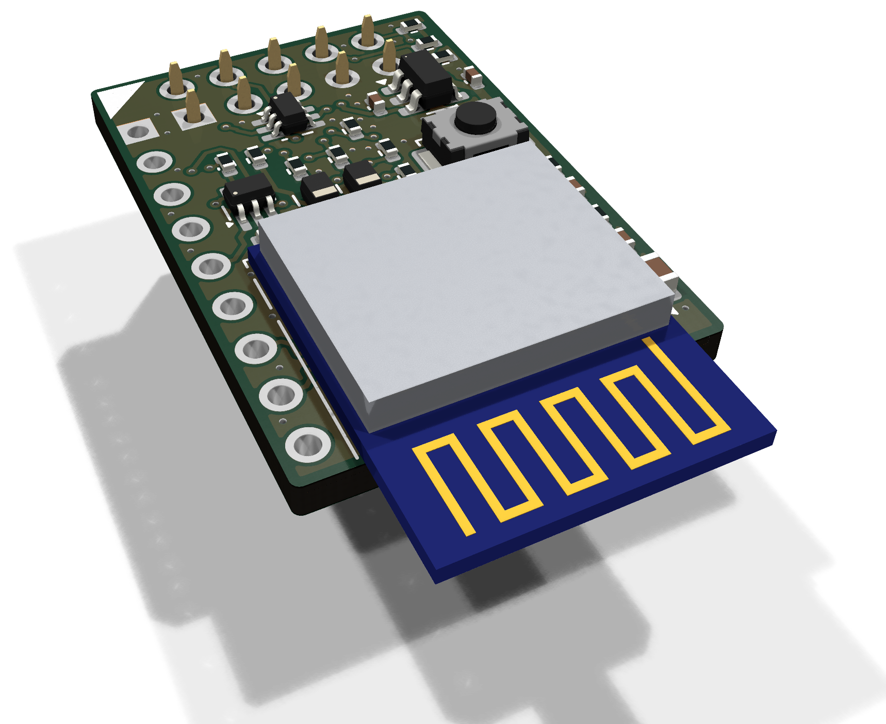
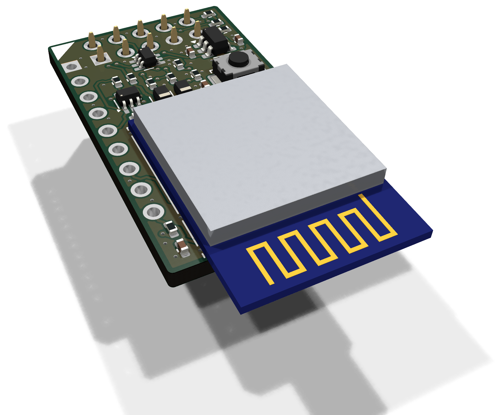

# airfrog-pcb

Airfrog is a tiny WiFi Hat that adds wireless networking to [One ROM](https://onerom.org).

| ESP32-C3 | ESP32-S3 |
| :---: | :---: |
|  |  |

<em>Currently untested - order at your own risk.</em>

## Files

Download the fab files, KiCad project and schematic PDF for each version from [Releases](../../releases) or generate them with `scripts/generate.sh`.

## Ordering

To have JLCPCB make and assemble the C3 board, upload the gerbers `airfrog-c3-gerbers.zip` and choose:

- 4 layers, 1.6 mm thick
- layer stackup JLC04161H-7628
- PCB assembly

Then upload a BOM and CPL:

- top side only soldering socket J1 by hand: `airfrog-c3-bom.csv` and `airfrog-c3-cpl.csv`
- both sides, with J1 fitted by JLCPCB: `airfrog-c3-socket-bom.csv` and `airfrog-c3-socket-cpl.csv`

Check the parts' positions in JLCPCB's preview before you place the order.

For the S3 board replace `c3` with `s3` in the filenames.

## Design

Schematics:

- [C3 (PDF)](../../releases/latest/download/airfrog-c3-schematic.pdf)
- [S3 (PDF)](../../releases/latest/download/airfrog-s3-schematic.pdf)

## Developing

All KiCad and fab files are auto-generated from scripts and configuration.

To modify or extend this design start with [DEVELOPMENT.md](DEVELOPMENT.md).

## License

(c) 2026 piers.rocks.

Licensed under the [CERN Open Hardware Licence Version 2 - Weakly Reciprocal](LICENSE) (CERN-OHL-W-2.0).

Boards made from this design must display piers.rocks, as set out in [NOTICE](NOTICE).
