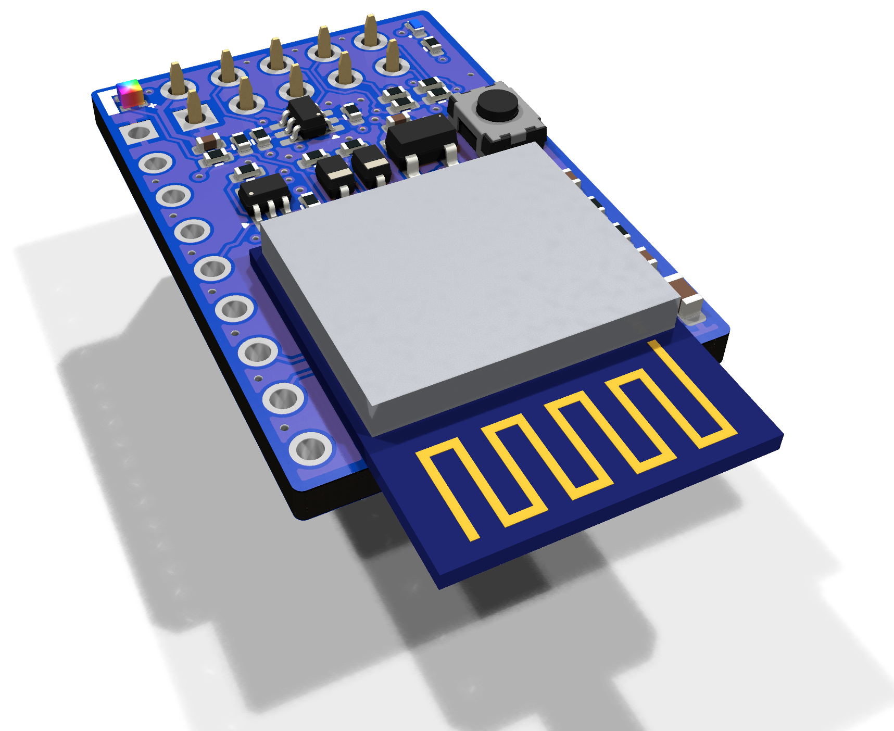
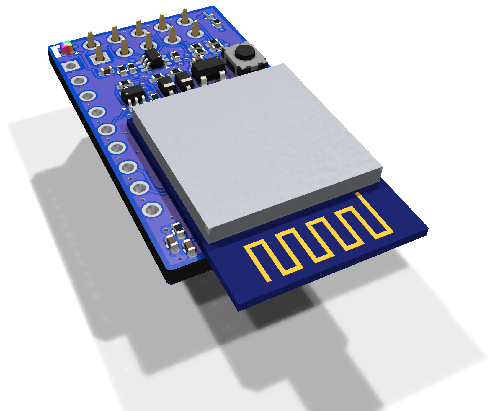

# airfrog-pcb

Airfrog is a tiny WiFi Hat that adds wireless networking to [One ROM](https://onerom.org).

| Mini (ESP32-C3) | Pro (ESP32-S3) |
| :---: | :---: |
|  |  |

<em>Currently untested - order at your own risk.</em>

## Files

Download the fab files, KiCad project and schematic PDF for each version from [Releases](../../releases) or generate them with `scripts/generate.sh`.

## Ordering

To have JLCPCB make and assemble the Mini, upload the gerbers `airfrog-mini-gerbers.zip` and choose:

- HASL or ENIG finish
- 4 layers, 1.6 mm thick
- layer stackup JLC04161H-7628
- PCB assembly
- your choice of solder mask colour (the official Airfrog board colour is blue)

Then upload a BOM and CPL:

- top side only soldering socket J1 by hand: `airfrog-mini-bom.csv` and `airfrog-mini-cpl.csv`
- both sides, with J1 fitted by JLCPCB: `airfrog-mini-socket-bom.csv` and `airfrog-mini-socket-cpl.csv`

Check the parts' positions in JLCPCB's preview before you place the order.

For the Pro replace `mini` with `pro` in the filenames.

## Design

Schematics:

- [Mini (PDF)](../../releases/latest/download/airfrog-mini-schematic.pdf)
- [Pro (PDF)](../../releases/latest/download/airfrog-pro-schematic.pdf)

## Developing

The schematics and fab files are generated from scripts. The PCBs are routed by hand in KiCad.

To modify or extend this design start with [DEVELOPMENT.md](DEVELOPMENT.md).

## License

(c) 2026 piers.rocks.

Licensed under the [CERN Open Hardware Licence Version 2 - Weakly Reciprocal](LICENSE) (CERN-OHL-W-2.0).

Boards made from this design must display piers.rocks, as set out in [NOTICE](NOTICE).
